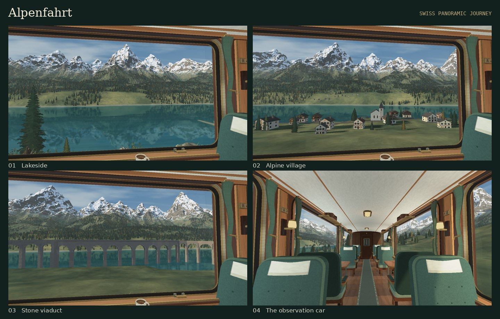

# Alpenfahrt

An imaginary Swiss rail journey, seen from a walnut-and-brass observation car. The train makes a continuous 4.096 km circuit at 64.8 km/h. Headphones are optional; the saloon starts quiet.

**[Download the self-contained ride](https://raw.githubusercontent.com/isiliconx/astra6.2-swiss/main/index.html)** (save the link as `index.html`, then open it in a WebGL 2 browser). No build, server, internet connection, images, models, or external libraries are required. Allow a few seconds for the scenery to be generated on first open.

### At the window

| Action | Control |
| --- | --- |
| Look around the carriage | Drag with a mouse or one finger. The horizon turns through 360°. |
| Zoom | Wheel or pinch with two fingers. |
| Return to the window | Wait about five seconds, double-click, or press the window button. |
| Pause, listen or go full screen | Use the controls on the right of the timetable. |
| Jump ahead | Choose Lakeside, Alpine village, Stone viaduct or Summit tunnel. |
| Keyboard | Focus the view. Arrow keys look, +/− zoom, Home or 0 recenters, Space pauses or resumes. |

The train starts paused when the browser requests reduced motion. Audio starts only after you turn it on.

### Under the hood

Everything lives in `index.html`. Seeded terrain, a drainage-derived rock and snow texture, hand-built chalet and carriage geometry, procedurally drawn conifer crowns, and arch-by-arch masonry provide real depth. The lake reflects a second render of the landscape; glass uses reflected carriage cameras. Trackside motion blur is calculated from depth, so nearby grass streaks while distant ridges hold still. Eye adaptation lags the tunnel transition. Wheel clatter and air are synthesized in the browser.
